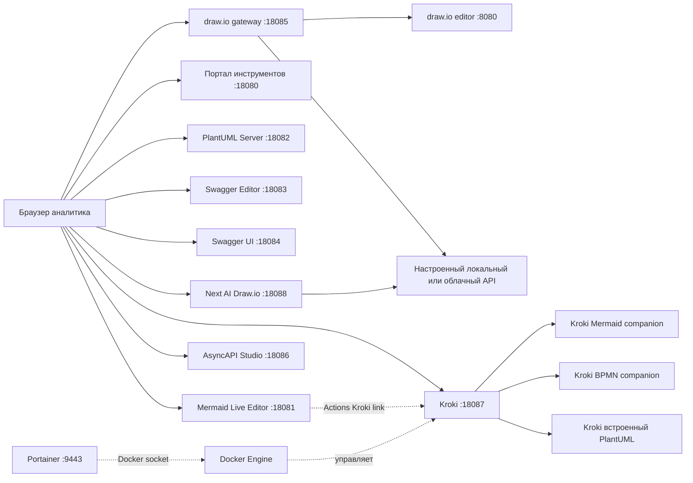

# Архитектура и порты

## Принцип

- **Один сервис — один контейнер** (кроме Kroki: основной шлюз + companion-сервисы рендеринга).
- Все приложения из `compose.yaml` находятся в **одной внутренней Docker-сети** проекта `sa-analyst-suite`.
- Portainer работает **отдельно** и видит все контейнеры через Docker socket.
- Портал на `18080` показывает ссылки на инструменты. Он не обращается к Docker socket, не проверяет их состояние и не пересылает документы.
- Редакторы в основном работают в браузере: **сам браузер пользователя** должен открывать опубликованные IP и порты.
- Файлы API храним вне контейнеров (в `specs/`, Git или Obsidian), не полагаемся на память браузера.

**Важно:** линия Mermaid → Kroki означает пользовательскую функцию (ссылку на рендер), а **не** то, что предпросмотр Live Editor автоматически рендерится через Kroki. Редактор продолжает строить предпросмотр своим JavaScript.

## Каталог сервисов

| Сервис | Образ / источник | Порт LAN → контейнер | Задача |
|---|---|---|---|
| Портал | `ghcr.io/denbond007/analyst-portal:1.0.0` | `18080 → 8080` | Единая стартовая страница с поиском и категориями |
| Portainer | `portainer/portainer-ce:lts` | `9443 → 9443` HTTPS | Управление Docker, отдельно |
| Mermaid Editor | `ghcr.io/denbond007/mermaid-live-editor-runtime:1.0.0` | `18081 → 8080` | Mermaid текст + preview + ссылка на свой Kroki |
| PlantUML Server | `plantuml/plantuml-server:jetty` | `18082 → 8080` | Веб-редактор PlantUML |
| Swagger Editor | `docker.swagger.io/swaggerapi/swagger-editor:next-v5` | `18083 → 80` | Разработка OpenAPI |
| Swagger UI | `docker.swagger.io/swaggerapi/swagger-ui:latest` | `18084 → 8080` | Отображение OpenAPI |
| draw.io gateway | Закреплённый Nginx без root | `18085 → 8080` | Редактор и same-origin прокси к модели; ключ только на сервере |
| draw.io | `jgraph/drawio:latest` | **нет**, внутр. `8080` | Схемы мышью и штатный AI; локальный JSON |
| AsyncAPI Studio | `asyncapi/studio:latest` | `18086 → 80` | Асинхронные API/Kafka |
| Kroki | `yuzutech/kroki:latest` | `18087 → 8000` | API генерации диаграмм |
| Next AI Draw.io | `ghcr.io/dayuanjiang/next-ai-draw-io:0.5.0` | `18088 → 3000` | Схемы через чат с LLM и обычное редактирование |
| Kroki Mermaid | `yuzutech/kroki-mermaid:latest` | **нет** (внутр. 8002) | Рендер Mermaid через Kroki |
| Kroki BPMN | `yuzutech/kroki-bpmn:latest` | **нет** (внутр. 8003) | BPMN через Kroki |
| Kroki Excalidraw | `yuzutech/kroki-excalidraw:latest` | **нет** (внутр. 8004) | Опционально через `--profile extras` |

## Адреса: LAN и Docker — не одно и то же

| Контекст | Пример |
|---|---|
| Браузер с MacBook/ПК | `http://192.168.88.42:18087` |
| Контейнер → контейнер | `http://kroki:8000` |
| Адрес Kroki, передаваемый Mermaid **при запуске** | `http://192.168.88.42:18087` |

**Нельзя** ставить `http://kroki:8000` в `KROKI_URL`, поскольку кнопка **Kroki** работает в браузере и браузер не знает Docker DNS-имени `kroki`.

## Где менять параметры

`BIND_IP`, порты, версия `MERMAID_IMAGE` и необязательный полный `KROKI_URL` — в `.env`. `${BIND_IP}` подставляет заданное значение, а не определяет IP. После смены IP/порта или `KROKI_URL` выполните `sudo docker compose up -d --no-build mermaid-editor`: контейнер перечитает настройки без пересборки образа.

См. [[02 - Установка и первый запуск]] и [[03 - Mermaid и локальный Kroki]].

Настройки портала — `PORTAL_IMAGE`, `PORTAL_PORT`, необязательные `PORTAL_HOST`, `PORTAL_TITLE`, `PORTAL_SHOW_PORTAINER` и `PORTAINER_URL`. В нём используются те же порты и `KROKI_URL`, что и у инструментов. После смены IP/портов применяйте весь Compose: `sudo docker compose up -d --no-build`, чтобы обновить и опубликованные порты приложений, и ссылки портала. Подробнее — [[15 - Портал инструментов]].

Для Next AI Draw.io задаются `AI_DRAWIO_IMAGE`, `AI_DRAWIO_PORT`, `AI_DRAWIO_BASE_URL`, `AI_DRAWIO_MODEL`, `AI_DRAWIO_API_KEY` и `AI_DRAWIO_MAX_OUTPUT_TOKENS`. К LLM обращается контейнер `ai-drawio`, ключ не входит в конфигурацию портала. Штатный AI обычного draw.io наследует то же подключение либо отдельные `DRAWIO_AI_*`. Браузер обращается к `/llm/chat/completions`, gateway добавляет настоящий ключ. `.local/drawio` формируется генератором и хранится на Docker-хосте. См. [[08 - draw.io]] и [[16 - Next AI Draw.io]].
