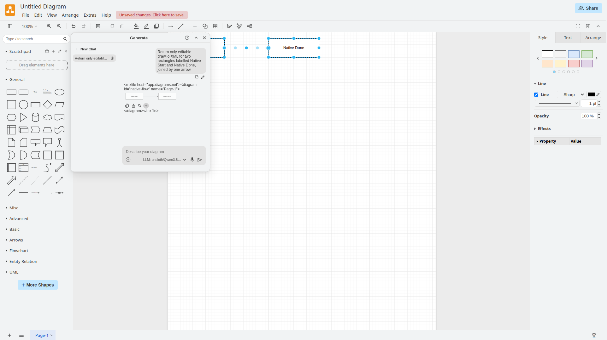

# draw.io / diagrams.net

**Назначение:** визуальные схемы и штатный AI-помощник без форка редактора.

**Адрес:** `http://<BIND_IP>:18085/?offline=0&https=0&mode=device`. На текущем ПК — `http://192.168.88.44:18085/?offline=0&https=0&mode=device`. Карточка обычного draw.io в [[15 - Портал инструментов]] уже открывает этот режим.

Next AI Draw.io на `18088` остаётся отдельным приложением, см. [[16 - Next AI Draw.io]]. Здесь описан **штатный AI обычного draw.io**.



## Что подготовлено автоматически

В базовом `compose.yaml` работают два сервиса:

- `drawio` — оригинальный `jgraph/drawio`, без публичного порта; читает локальный JSON через `DRAWIO_CONFIG_FILE`.
- `drawio-gateway` — Nginx без root, публикует прежний LAN-порт `18085`, отдаёт редактор и проксирует только `/llm/chat/completions` к настроенному API модели.

Браузер отправляет запрос на тот же origin, откуда открыт редактор. **Настоящий ключ добавляет Nginx на сервере**; браузер получает только маркер `local-proxy`. Поэтому отдельно настраивать CORS Unsloth/Ollama и разрешать внешний адрес LLM в браузерной CSP не требуется. В CSP остаётся `connect-src 'self'`.

Публичный AI-backend draw.io отключён: в `aiActions` только `create` и `update`. Облачные хранилища отключаются upstream Docker-образом; работа ведётся в Device. `offline=0` нужен для появления Generate: в проверенном draw.io 32.6.1 `offline=1` скрывает AI даже при `enableAi: true`.

## Где хранится конфигурация

| Файл | Назначение |
|---|---|
| `.env` | Постоянные адрес API, модель, ключ и флаг AI; исключён из Git |
| `.local/drawio/drawio.json` | Сгенерированные публичные настройки редактора: модель, лимит, относительный endpoint; реального ключа нет |
| `.local/drawio/nginx.conf` | Сгенерированный серверный маршрут и настоящий ключ API; не отдаётся браузеру |
| `scripts/prepare-drawio-ai.py` | Генератор обоих файлов из разрешённого окружения Compose |

Каталог `.local/drawio` исключён из Git и имеет права `700`. Файлы внутри читаются непривилегированными контейнерами через отдельные read-only mounts. К Docker socket редактор и gateway доступа не имеют. Конфигурация остаётся на этом ПК; Docker volume для неё не нужен.

Меняйте постоянные значения в `.env`: генератор перезаписывает производные файлы. Не публикуйте `nginx.conf` и вывод `docker compose config` без `--quiet`: они могут содержать ключ.

## Новое развёртывание

Нужны Docker Engine, Compose, curl, Python 3 и доступ к LAN API модели.

```bash
cp -n .env.example .env
nano .env
bash scripts/first-run.sh
```

В `.env` укажите IP Docker-хоста и подключение модели. Например, для текущей топологии:

```dotenv
BIND_IP=192.168.88.44
PORTAL_IMAGE=local/analyst-portal:dev
DRAWIO_AI_ENABLED=true
DRAWIO_LANG=ru
AI_DRAWIO_BASE_URL=http://192.168.88.42:8888/v1
AI_DRAWIO_MODEL=unsloth/Qwen3.8-27B-GGUF
AI_DRAWIO_MAX_OUTPUT_TOKENS=8192
```

Ключ хранится в `AI_DRAWIO_API_KEY` в той же приватной `.env`; в инструкции его нет. Эти переменные используются и Next AI Draw.io. **Для текущего ПК подключение уже задано, повторно вводить ключ не нужно.**

`first-run.sh` проверяет настройки, создаёт `.local/drawio`, скачивает образы и собирает актуальный портал, если выбран локальный тег. Затем пересоздаёт draw.io/gateway для загрузки файлов. Ручная настройка Extras → Configuration не требуется.

При включённом AI отсутствие модели/ключа или некорректный URL останавливает подготовку, без перехода на публичный AI. Если LLM пока нет, задайте `DRAWIO_AI_ENABLED=false`: редактор запускается без AI, прокси-маршрут закрыт, ссылка портала использует offline mode.

`compose.drawio-ai.yaml` оставлен для совместимости прежних команд; дополнительные настройки из него больше не нужны. Прежний `drawio-ai.local.json` не используется новым стандартным запуском.

## Независимая модель для штатного AI

По умолчанию используются `AI_DRAWIO_*` из [[16 - Next AI Draw.io]]. Чтобы обычный draw.io обращался к другому API, переопределите в `.env`:

```dotenv
DRAWIO_AI_BASE_URL=http://192.168.88.42:8888/v1
DRAWIO_AI_MODEL=unsloth/Qwen3.8-27B-GGUF
DRAWIO_AI_MAX_TOKENS=8192
```

Отдельный ключ задаётся в `DRAWIO_AI_API_KEY`; без него наследуется `AI_DRAWIO_API_KEY`.

| Сервер | Базовый URL | Модель/ключ |
|---|---|---|
| Unsloth | `http://<LAN IP>:8888/v1` | Точный ID из `/v1/models`, ключ Unsloth |
| Ollama на Docker-хосте | `http://host.docker.internal:11434/v1` | Установленная модель; для API без авторизации непустой маркер `ollama` |
| Ollama на другом ПК | `http://<LAN IP>:11434/v1` | Сервер должен быть доступен контейнеру gateway |
| DeepSeek | `https://api.deepseek.com/v1` | Актуальный ID и ключ DeepSeek |
| OpenAI | `https://api.openai.com/v1` | Доступная модель Chat Completions и ключ OpenAI API |

Здесь нужен **базовый URL**, без `/chat/completions`: генератор добавит путь сам. `localhost` означал бы контейнер gateway; для модели на Docker-хосте предусмотрен `host.docker.internal`. При смене API весь запрос и XML схемы будут получать его серверы. Генератор использует стандартный `max_tokens`; выбранная модель должна поддерживать этот параметр Chat Completions.

## Время ожидания генерации

`generateTimeout` штатного draw.io установлен в **600 000 мс — 10 минут**. Gateway добавляет локальный `docker/drawio/ai-runtime.js` после исходного `PostConfig.js`, сохраняя штатные настройки редактора. `proxy_read_timeout` и `proxy_send_timeout` также выставлены в **600 секунд**; это таймауты отсутствия данных/прогресса передачи на прокси, а не дополнительное время сверх таймаута интерфейса.

После применения обновления перезагрузите уже открытую вкладку draw.io без кэша (`Ctrl+F5`), чтобы она загрузила новый `generateTimeout`.

## Применить изменения без пересборки draw.io

```bash
python3 scripts/prepare-drawio-ai.py
sudo docker compose config --quiet
sudo docker compose up -d --no-build --force-recreate drawio drawio-gateway portal
```

Для генератора sudo не нужен. `--force-recreate` важен: конфиги обновляются атомарно, а bind mount работающего контейнера может продолжать указывать на старый файл. Простой `restart` не загрузит новые переменные Compose. Обновите страницу без кэша.

`bash scripts/update.sh` также заново подготавливает файлы и пересоздаёт эти сервисы. После обычного `docker compose down` локальные настройки остаются; если `.local` удалён, сначала повторите генератор.

## Как пользоваться

1. Откройте карточку **draw.io** в портале. Создайте пустую схему или откройте сохранённую через **Device / Устройство**.
2. Выберите **Arrange → Insert → Generate / Упорядочить → Вставить → Создать**; перевод названия зависит от языка UI.
3. В списке модели выберите пункт **LLM: …**. Настраивать провайдера или вводить ключ в браузере не требуется.
4. Опишите задачу: «Создай диаграмму оформления заказа: Клиент → API → Склад → Оплата. Все подписи на русском. Верни редактируемую схему draw.io».
5. Дождитесь предпросмотра. Наведите на кнопку вставки под ним и выберите **Insert / Вставить**, чтобы добавить фигуры на холст.
6. Для изменения существующего рисунка прикрепите **File / Page / Selection** через `+`. Например, выделите оплату и попросите добавить отказ; затем используйте **Apply / Применить**. Без вложения модель не получает текущую схему автоматически.
7. Продолжайте редактировать мышью. Сохраняйте исходный `.drawio` и экспорт SVG/PNG на устройство/Git. История чата не заменяет сохранение файла.

Если ранее в Extras → Configuration или браузерном профиле были заданы старые AI-параметры, очистите их либо проверьте в чистом профиле: локальные настройки браузера могут перекрывать серверную конфигурацию.

## Как это связано с gptUrl и aiConfigs

Редактор по-прежнему использует штатные `enableAi`, `aiModels` и `aiConfigs`. В сгенерированном JSON endpoint имеет значение `/llm/chat/completions`, модель — из `.env`, а ответ извлекается по `$.choices[0].message.content`. Настоящего ключа в `aiGlobals` нет: `gptApiKey=local-proxy` только делает модель доступной в интерфейсе.

Параметр `gptUrl` удобен для прямого OpenAI-совместимого API. Здесь выбран `aiConfigs`, чтобы дополнительно задать лимит `max_tokens`, обычный JSON-ответ вместо stream и передавать авторизацию только на стороне gateway. Системные инструкции создания/изменения и вложения схемы предоставляет сам draw.io; `aiGlobals` целиком не заменяется.

Файлы `samples/drawio-ai-ollama.json` и `samples/drawio-ai-custom.example.json` остаются учебными примерами прямого браузерного подключения. В стандартном развёртывании их копировать не требуется; direct mode потребовал бы отдельной политики CSP/CORS и сделал бы ключ доступным браузеру.

## Проверки и диагностика

```bash
sudo docker compose ps drawio drawio-gateway
bash scripts/healthcheck.sh
```

HTTP-проверка не вызывает LLM. Сквозная проверка делает один реальный запрос к выбранной модели:

```bash
npm ci --ignore-scripts
npm test
npm run test:portal
npx playwright install chromium
DRAWIO_TEST_URL=http://192.168.88.44:18085 npm run test:drawio:browser
```

- **Нет Generate:** проверьте `DRAWIO_AI_ENABLED=true`, URL с `offline=0`, завершение подготовки и отсутствие старой конфигурации в браузере.
- **Compose не находит bind mount:** выполните генератор; каталоги вместо отсутствующих файлов автоматически не создаются.
- **502:** проверьте доступность API модели из Docker-сети, URL и состояние Unsloth/Ollama.
- **401/403 от модели:** проверьте ключ в `.env`, затем генератор и пересоздание gateway.
- **Нет ответа или XML обрезан:** уменьшите задачу либо увеличьте `DRAWIO_AI_MAX_TOKENS`; проверьте, что модель выдаёт финальный текст, а не только reasoning.
- **AI отключён:** `/llm/chat/completions` возвращает 404. Другие маршруты `/llm/*` всегда закрыты.

`scripts/backup-config.sh` включает `.env` и `.local/drawio`; архив создаётся с правами `600`. Он содержит секреты. Данные Next AI Draw.io/Portainer в volumes резервируются отдельно, см. [[10 - Эксплуатация, обновления и резервное копирование]].

**Перепроверено 28 октября 2026 года:** браузер получил преднастроенную модель без настоящего API-ключа, отправил запрос через локальный proxy в Unsloth и вставил на холст две редактируемые фигуры `Native Start`/`Native Done` со стрелкой. Внешних браузерных HTTP-загрузок не было. Локальные конфиги совпали с файлами, подключёнными к контейнерам. Скриншот выше снят в этой проверке; для теста выбран английский интерфейс.

draw.io сам задаёт `Content-Type: application/json`, поэтому в `requestHeaders` этот заголовок повторно не добавляется. Gateway также нормализует его перед отправкой в Unsloth. Дублирование заголовка, обнаруженное при первой проверке, исправлено и покрыто тестами.

Источники: [AI-настройки draw.io](https://www.drawio.com/docs/reference/diagram-generation/configure-ai-options/), [Docker-образ](https://github.com/jgraph/docker-drawio), [Ollama API](https://docs.ollama.com/api/openai-compatibility), [DeepSeek API](https://api-docs.deepseek.com/). Проверенная версия draw.io — 32.6.1.
