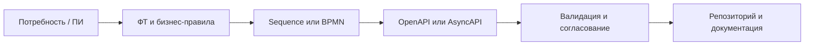
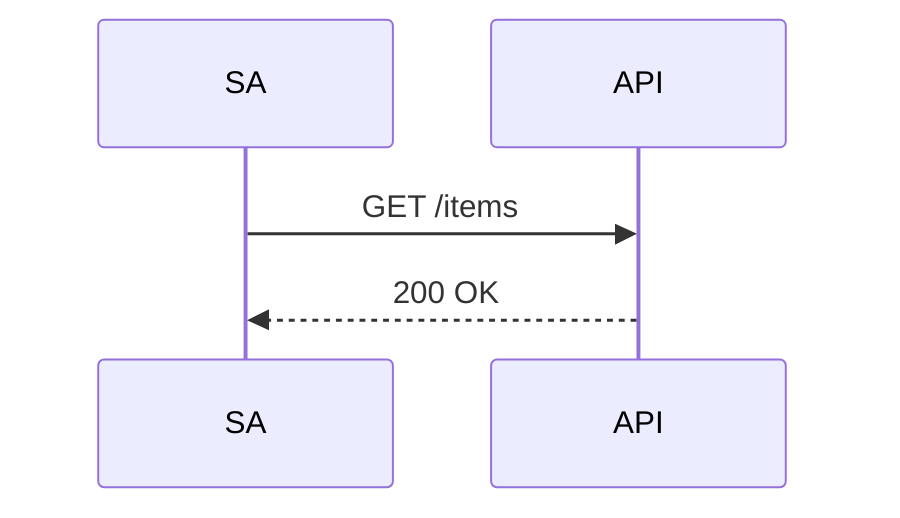

# Образцы и рабочий процесс системного аналитика

## Рекомендуемый путь от потребности до проверяемого контракта



## Какой инструмент использовать

| Задача | Инструмент | Артефакт |
|---|---|---|
| Быстрая последовательность взаимодействия | Mermaid Live Editor | `.mmd` и `.svg` |
| Детализированная UML sequence/component/class | PlantUML Server | `.puml` и `.svg` |
| BPMN схема деятельности | draw.io; или рендер BPMN через Kroki API | `.drawio` или BPMN XML + `.svg` |
| Архитектура приложений и контекст интеграций | draw.io, PlantUML/C4, Mermaid | `.drawio`/`.puml`/`.mmd` |
| REST API и ошибки контрактов | Swagger Editor, Swagger UI | `openapi.yaml` |
| Kafka/event-driven взаимодействие | AsyncAPI Studio | `asyncapi.yaml` |
| Автоматическая отрисовка в CI | Kroki API | `.svg`/`.png` |
| Эксплуатация стенда | Portainer | Контейнеры, логи, статистика |

## Связь каждого продукта с Kroki

| Продукт | Интеграция с Kroki | Ограничение |
|---|---|---|
| Mermaid Live Editor | **Прямая**: настраиваемая ссылка Actions → локальный Kroki | Live preview остаётся на встроенном движке Mermaid |
| PlantUML Server | **Параллельный вариант**: Kroki сам содержит PlantUML | Не заменяет управление сервером PlantUML из его UI |
| draw.io | Косвенно: импорт/вставка экспортированного SVG/PNG | Рендер Kroki не становится редактируемым `.drawio` |
| Swagger Editor | Косвенно: Markdown-ссылки на изображения | Нет собственного Kroki renderer |
| Swagger UI | Косвенно: ссылки в OpenAPI descriptions | Влияют CSP/браузер/доступность URL |
| AsyncAPI Studio | Косвенно через внешние материалы | Не заявляем прямой подключаемый Kroki renderer |
| Portainer | Управление контейнером Kroki | Не редактор диаграмм |

## Что лежит в примерах

- `samples/flow.mmd` — цепочка ПИ → ФТ → OpenAPI.
- `samples/sequence.mmd` — Mermaid sequence для API.
- `samples/sequence.puml` — тот же сценарий PlantUML.
- `specs/openapi.yaml` — OpenAPI демонстрационного `/health`.
- `samples/asyncapi.yaml` — AsyncAPI 3.0 для Kafka-события.

## Obsidian и CI

Obsidian отображает многие блоки Mermaid нативно:

````markdown

````

Для строгого контроля версий храните **исходник диаграммы в Git**, а SVG получайте через локальный Kroki из CI либо вручную. Obsidian не требует Kroki для встроенного `mermaid` code fence. Плагин Obsidian для Kroki — отдельная интеграция и не устанавливается этим Docker Compose автоматически.

> [!tip] Организация документации
> Рекомендуемые каталоги в рабочем репозитории: `requirements/`, `diagrams/source/`, `diagrams/rendered/`, `contracts/openapi/`, `contracts/asyncapi/`, `adr/`. Согласованная структура облегчает трассируемость ПИ → ФТ → контракт → проверка.
