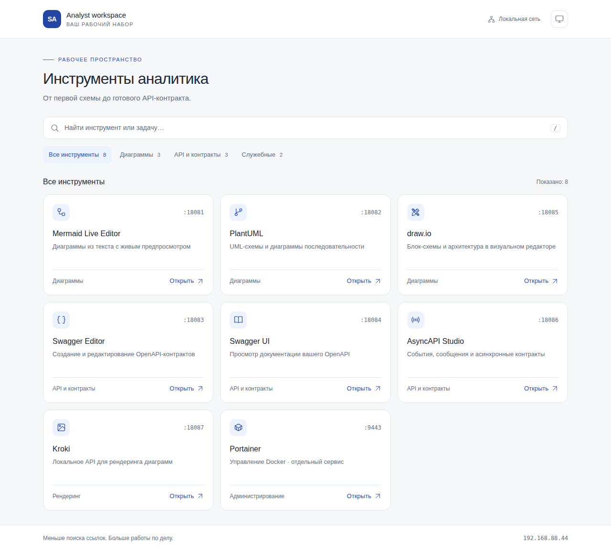
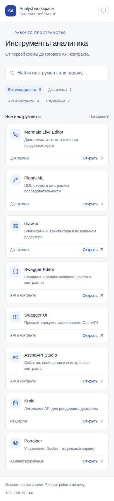

# Портал инструментов

Стартовая страница `http://<BIND_IP>:18080` собирает ссылки на Mermaid, PlantUML, draw.io, Swagger Editor, Swagger UI, AsyncAPI Studio, Kroki и Portainer. Её удобно сохранить в закладках или назначить стартовой страницей браузера.



## Возможности

- Карточки с назначением инструмента и кнопкой открытия в новой вкладке.
- Поиск по названию и задаче: например, `Kafka`, `сваггер`, `кроки` или `диаграммы`.
- Категории «Диаграммы», «API и контракты», «Служебные».
- Светлая, тёмная и системная тема; выбор сохраняется в браузере.
- Адаптация для телефона. `/` переводит фокус в поиск, `Escape` очищает его.

Карточки — ссылки, а не индикаторы доступности. Kroki открывает API-сервис; Portainer устанавливается отдельно. Проверка набора выполняется через `bash scripts/healthcheck.sh`.

## Запуск

Портал входит в основной `compose.yaml`. Для новой установки используйте [[02 - Установка и первый запуск]]. Для уже работающего набора:

```bash
sudo docker compose pull portal
sudo docker compose up -d --no-build portal
```

Готовый образ: `ghcr.io/denbond007/analyst-portal:1.0.0`, платформы AMD64 и ARM64. Образ распространяется через GHCR вместе с исходниками в этом Git-репозитории; бинарные Docker-слои в Git не добавляются.

## Настройки

| Переменная `.env` | По умолчанию | Назначение |
|---|---|---|
| `BIND_IP` | Пример `192.168.88.42` | IP интерфейса сервера для публикации портов и ссылок |
| `PORTAL_IMAGE` | `ghcr.io/denbond007/analyst-portal:1.0.0` | Версия образа |
| `PORTAL_PORT` | `18080` | Внешний порт стартовой страницы |
| `PORTAL_HOST` | Значение `BIND_IP` | IP или DNS для ссылок в браузере, без `http://` и порта |
| `PORTAL_TITLE` | `Инструменты аналитика` | Заголовок страницы и вкладки |
| `PORTAL_SHOW_PORTAINER` | `true` | Показать карточку; `false` скрывает её |
| `PORTAINER_URL` | `https://<PORTAL_HOST>:<PORTAINER_PORT>` | Полный адрес отдельно установленного Portainer |
| `KROKI_URL` | `http://<BIND_IP>:<KROKI_PORT>` | Тот же адрес Kroki, что передаётся Mermaid |

Остальные ссылки используют `PORTAL_HOST` и уже существующие переменные `MERMAID_PORT`, `PLANTUML_PORT`, `SWAGGER_EDITOR_PORT`, `SWAGGER_UI_PORT`, `DRAWIO_PORT`, `ASYNCAPI_PORT`. Для draw.io всегда сохраняется `?offline=1&https=0`.

Не указывайте пароли или токены в URL. Настройки ссылок доступны посетителю в `/runtime-config.js`; остальная `.env` в браузер не передаётся.

После изменения только заголовка, ссылок или флага Portainer:

```bash
sudo docker compose up -d --no-build portal
```

При изменении `BIND_IP`, портов приложений или `KROKI_URL` примените весь набор, чтобы ссылки и контейнеры использовали одинаковые значения:

```bash
sudo docker compose up -d --no-build
```

Настройки формируются при создании контейнера, пересборка образа не требуется. Простой `restart` не перечитывает изменённую `.env`.

## Локальная сборка и проверка

```bash
npm ci --ignore-scripts
npm run test:portal
sudo docker compose -f compose.yaml -f compose.build.yaml build portal
npx playwright install chromium
npm run test:portal:browser
```

Браузерные тесты обращаются к локальному Docker; запускайте из учётной записи с доступом к нему. Они поднимают временные контейнеры на случайных loopback-портах и удаляют их после проверки. Для уже установленного Chrome можно передать `PLAYWRIGHT_CHROMIUM_EXECUTABLE_PATH=/usr/bin/google-chrome`.

Запуск локально собранного образа:

```bash
sudo docker compose -f compose.yaml -f compose.build.yaml up -d --no-build portal
```

После возврата к опубликованной версии выполняйте команды без `compose.build.yaml`.

## Публикация новой версии

Workflow `.github/workflows/publish-portal.yml` проверяет генератор настроек, Compose и интерфейс в Chromium, затем собирает образ для `linux/amd64` и `linux/arm64` и публикует его в GHCR. Публикация запускается вручную через Actions с параметром `version` или тегом:

```bash
git tag portal-v1.0.1
git push origin portal-v1.0.1
```

Тег `portal-v…` относится к порталу, а `v…` — к Mermaid. Образу назначаются теги версии, `sha-<commit>` и `latest` для стабильного выпуска. Для развёртывания используйте конкретную версию в `PORTAL_IMAGE`.

Новый пакет GHCR по умолчанию может быть приватным: владелец делает его публичным через настройки пакета. После публикации проверьте скачивание без авторизации, прежде чем распространять Compose для анонимного использования.

## Изоляция

Nginx работает без root, с файловой системой только для чтения и временным каталогом `/tmp`. Все стили, JavaScript, иконки и шрифты локальны; CDN и аналитика не используются. Портал не получает Docker socket и не опрашивает приложения. Доступ к самому порталу ограничивается LAN/VPN, как и к остальным редакторам; см. [[11 - Конфиденциальность и безопасность]].


