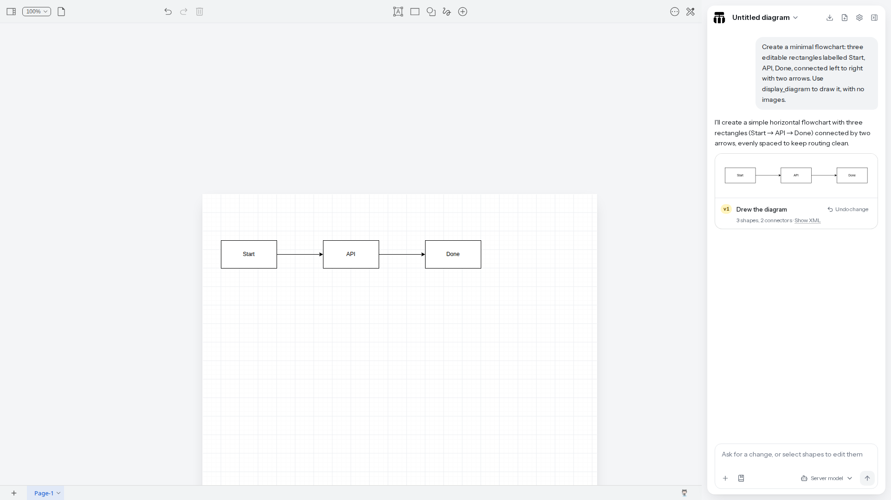

# Next AI Draw.io: локальная LLM и работа через чат

**Адрес:** `http://<BIND_IP>:18088`. На ПК, где выполнено развёртывание 27 октября 2026 года: `http://192.168.88.44:18088`. Ссылка также есть в [[15 - Портал инструментов]].

Это отдельное приложение [Next AI Draw.io](https://github.com/DayuanJiang/next-ai-draw-io), использующее обычный формат `.drawio`. Оно отправляет описание и контекст схемы модели, применяет её изменения к визуальному редактору и позволяет продолжать работу мышью. Обычный draw.io остаётся на `18085`; его собственная AI-функция описана в [[08 - draw.io]].



## Образ и конфигурация

В `compose.yaml` добавлен сервис `ai-drawio`, образ `ghcr.io/dayuanjiang/next-ai-draw-io:0.5.0`. Тег проверен в GHCR, доступны Linux AMD64 и ARM64. Проверенный digest индекса: `sha256:88193c4319732a65c89924fd95e6db80439889eac91b0e25af756e07e73e672b`. При необходимости закрепите его в `AI_DRAWIO_IMAGE`.

Сервис принимает **OpenAI-совместимый Chat Completions API**, включая локальный Unsloth/Ollama, DeepSeek и OpenAI. В закреплённой версии 0.5.0 используется адаптер `openai` с явно заданным адресом: это формат обмена, а не обязательная отправка данных в OpenAI. Куда идут запросы, определяет `AI_DRAWIO_BASE_URL`. Провайдер `custom`, описанный в текущем upstream, в образе 0.5.0 ещё отсутствует.

| Переменная `.env` | Назначение |
|---|---|
| `AI_DRAWIO_IMAGE` | Версия образа, по умолчанию `ghcr.io/dayuanjiang/next-ai-draw-io:0.5.0` |
| `AI_DRAWIO_PORT` | LAN-порт, по умолчанию `18088` |
| `AI_DRAWIO_BASE_URL` | Базовый адрес API, обычно с `/v1`; **не** полный путь `/chat/completions` |
| `AI_DRAWIO_MODEL` | Точный ID модели из `/v1/models` |
| `AI_DRAWIO_API_KEY` | Ключ выбранного сервера; хранить только в игнорируемой `.env` |
| `AI_DRAWIO_MAX_OUTPUT_TOKENS` | Лимит вывода модели, по умолчанию `8192`; включает reasoning и XML |

В контейнер передаются `AI_PROVIDER=openai`, `OPENAI_BASE_URL`, `OPENAI_API_KEY` и `AI_MODEL`. Имена переменных относятся к адаптеру; их значения в нашей установке принадлежат **локальному Unsloth**. Ключ не передаётся статическому порталу. Панель администратора upstream по умолчанию выключена: `ADMIN_PASSWORD` не задан. Доступ к общей серверной модели получают посетители приложения в доверенной LAN/VPN.

## Подключение локального Unsloth

На проверенной установке сервер моделей расположен **на другом ПК**: `192.168.88.42:8888`, а Docker-набор — на `192.168.88.44`. Настройки в `.env`:

```dotenv
AI_DRAWIO_IMAGE=ghcr.io/dayuanjiang/next-ai-draw-io:0.5.0
AI_DRAWIO_PORT=18088
AI_DRAWIO_BASE_URL=http://192.168.88.42:8888/v1
AI_DRAWIO_MODEL=unsloth/Qwen3.8-27B-GGUF
AI_DRAWIO_MAX_OUTPUT_TOKENS=8192
```

Ключ добавляется отдельной строкой `AI_DRAWIO_API_KEY` в приватную `.env`; в этой инструкции его нет. Ответ `/v1/models` подтвердил, что указанная модель загружена. При выборе другой модели сначала загрузите её в Unsloth и проверьте ID. Ключ OpenAI для такого подключения не нужен.

```bash
sudo docker compose config --quiet
sudo docker compose pull ai-drawio
sudo docker compose up -d --no-build ai-drawio
sudo docker compose ps ai-drawio
bash scripts/healthcheck.sh
```

После изменения адреса, модели или ключа выполните `up -d --no-build ai-drawio`; простой `restart` не загрузит новые значения из Compose. Не публикуйте вывод `docker compose config` без `--quiet`: он содержит развёрнутые секреты.

## Другие провайдеры через тот же сервис

| Сервер | `AI_DRAWIO_BASE_URL` | Модель и авторизация |
|---|---|---|
| Unsloth | `http://<IP сервера>:8888/v1` | ID из `/v1/models`, ключ Unsloth |
| Ollama на Docker-хосте | `http://host.docker.internal:11434/v1` | ID установленной модели; для сервера без авторизации подходит непустое значение `ollama` |
| Ollama на другом ПК | `http://<LAN IP>:11434/v1` | Сервис должен слушать доступный контейнеру интерфейс |
| LM Studio | `http://<LAN IP>:1234/v1` | ID загруженной модели; ключ по настройкам сервера |
| DeepSeek | `https://api.deepseek.com/v1` | Актуальный ID из API DeepSeek, ключ DeepSeek |
| OpenAI | `https://api.openai.com/v1` | Доступная модель с Chat Completions/tool calling, ключ OpenAI API |

Для моделей, доступных только через другой протокол, выберите соответствующий провайдер в настройках самого приложения; это уже отдельная конфигурация. Образ поддерживает и собственные адаптеры провайдеров. Не вставляйте конфигурацию OpenAI в рабочую Unsloth-настройку, если хотите сохранить локальную обработку.

Здесь запрос к LLM делает **Node-сервер контейнера**. Поэтому `localhost` означал бы сам контейнер; для сервера на Docker-хосте предусмотрено `host.docker.internal:host-gateway`. В обычном draw.io браузер теперь обращается к локальному gateway, который также хранит ключ на сервере; см. [[08 - draw.io]]. CORS браузера между редактором и LLM в обоих стандартных маршрутах не требуется.

## Как пользоваться

1. Откройте `http://<BIND_IP>:18088`, дождитесь исчезновения **Loading the canvas…** и нажмите **Start with a blank canvas**. В выборе модели используйте **Server model**; вводить общий ключ в браузере не требуется.
2. В поле чата опишите состав схемы, направления связей и нужные подписи. Например: «Нарисуй процесс оформления заказа: Клиент → API → Проверка остатков → Оплата → Заказ подтверждён. Все подписи на русском».
3. Дождитесь появления элементов на холсте. Проверьте смысл связей и подписи: валидный XML сам по себе не подтверждает правильность архитектуры.
4. Уточните: «Добавь отказ оплаты и возврат к выбору способа оплаты». При необходимости выделите элементы и попросите изменить только их. Продолжайте обычное редактирование мышью.
5. Используйте историю версий и отмену для возврата к предыдущему варианту.
6. Сохраните редактируемый `.drawio`, затем экспортируйте SVG/PNG для документа. Сохраняйте исходники рядом с заметками/Git.

Для небольших первых схем не загружайте весь проект: короткий запрос легче проверить. Генерация требует модели, способной выдавать корректные вызовы инструментов и длинный XML. Поддержка OpenAI-формата у сервера ещё не гарантирует такую способность у каждой модели.

## Локальные assets, данные и обновление

В образе 0.5.0 редактор draw.io поставляется внутри приложения и открывается с того же origin. Отдельный контейнер `drawio` ему не требуется. `NEXT_PUBLIC_DRAWIO_BASE_URL` — **параметр сборки**, а не способ переключить готовый образ при запуске. Внешняя ссылка на embed.diagrams.net не задаётся.

Контейнер работает без root, с read-only rootfs, временными `/tmp` и кэшем Next.js; Docker socket не подключён. Named volume `ai_drawio_data` монтируется в `/app/data` для серверных настроек upstream. Это не общее файловое хранилище пользовательских схем: `.drawio` нужно сохранять отдельно. `scripts/backup-config.sh` включает `.env`, но **не данные volume**, см. [[10 - Эксплуатация, обновления и резервное копирование]].

Портал с новой карточкой собирается локально, пока она не включена в следующий опубликованный образ портала:

```bash
sudo docker compose -f compose.yaml -f compose.build.yaml build portal
# В .env задайте PORTAL_IMAGE=local/analyst-portal:dev
sudo docker compose up -d --no-build portal
```

На этом ПК эта настройка уже применена. `scripts/update.sh` распознаёт `local/analyst-portal:dev`, скачивает остальные образы и пересобирает портал. При ручном обновлении не выполняйте `docker compose pull portal` для локального тега.

## Проверки

`bash scripts/healthcheck.sh` проверяет HTTP и Kroki, но не вызывает LLM. Для отдельного сквозного теста нужен настроенный и работающий `ai-drawio`:

```bash
npm ci --ignore-scripts
npx playwright install chromium
AI_DRAWIO_TEST_URL=http://192.168.88.44:18088 npm run test:ai-drawio:browser
```

Тест делает **один реальный запрос** к выбранной серверной модели, проверяет появление трёх подписанных фигур на холсте и отсутствие внешних браузерных загрузок. Для облачного провайдера такой запуск расходует его API-лимит. Без `AI_DRAWIO_TEST_URL` этот тест пропускается; он не входит в обычные runtime-тесты.

**Результат 27 октября 2026 года:** сквозной тест пройден с локальной `unsloth/Qwen3.8-27B-GGUF`: созданы 3 фигуры и 2 соединителя, ответ завершился, редактор остался доступен для обычного редактирования. Скриншот выше снят с этого приложения. Облачные DeepSeek/OpenAI и другой сервер Ollama в этой проверке не вызывались.

Источники: [провайдеры](https://github.com/DayuanJiang/next-ai-draw-io/blob/main/docs/en/ai-providers.md), [Docker](https://github.com/DayuanJiang/next-ai-draw-io/blob/main/docs/en/docker.md), [локальная сеть без интернета](https://github.com/DayuanJiang/next-ai-draw-io/blob/main/docs/en/offline-deployment.md), [Ollama API](https://docs.ollama.com/api/openai-compatibility), [DeepSeek API](https://api-docs.deepseek.com/), [OpenAI API](https://developers.openai.com/api/reference/overview).
